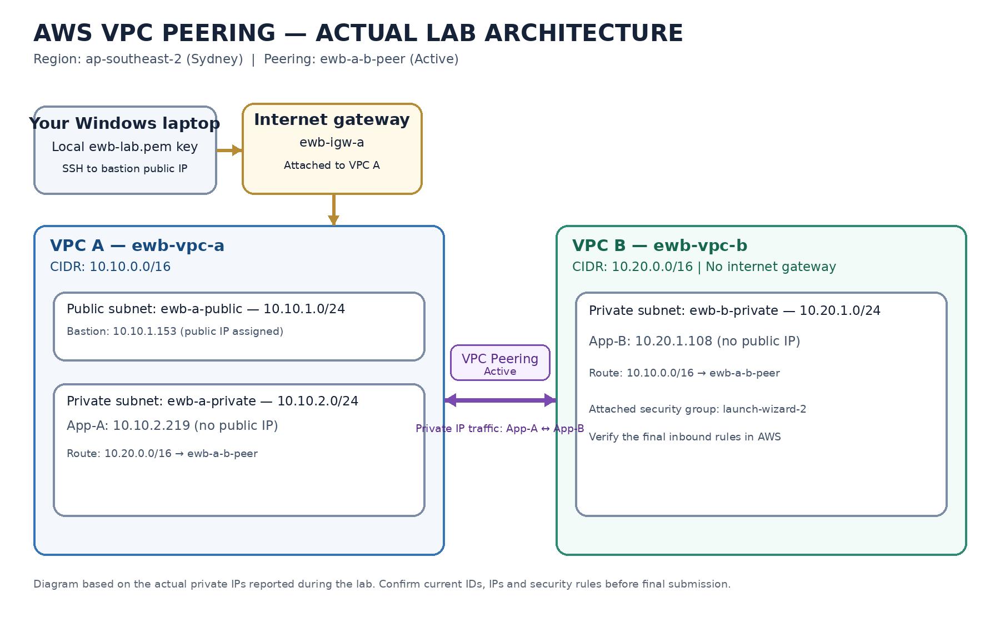

# AWS VPC Peering Project — EWB Cloud Labs

> **Project status:** Core VPC peering connectivity has been configured and tested. The report still needs evidence for any tests not yet run, the actual AWS resource IDs, security-group screenshots, and cleanup.

## 1. Project overview

This project implements **VPC Peering between two Amazon Virtual Private Clouds (VPCs)** in AWS. The purpose is to allow two private EC2 workloads to communicate over private IPv4 addresses without assigning public IPv4 addresses to the application instances.

A bastion host in VPC A provides an administrative entry point. VPC peering connects VPC A and VPC B; route tables and security-group rules control whether traffic can pass.

**AWS Region:** Asia Pacific (Sydney) — `ap-southeast-2`

## 2. Architecture



The design contains:
- **VPC A:** `10.10.0.0/16`
  - Public subnet: `ewb-a-public` — `10.10.1.0/24`
  - Private subnet: `ewb-a-private` — `10.10.2.0/24`
  - Internet gateway: `ewb-igw-a`
  - Bastion host: `ewb-bastion`
  - Private application instance: `ewb-app-a`
- **VPC B:** `10.20.0.0/16`
  - Private subnet: `ewb-b-private` — `10.20.1.0/24`
  - Private application instance: `ewb-app-b`
  - No internet gateway was required for this lab
- **VPC peering connection:** `ewb-a-b-peer` — status was confirmed as **Active**.

The VPC CIDRs do not overlap. The application instances use private IP addresses and do not need public IPv4 addresses to communicate over the peering connection.

## 3. Actual resource addressing recorded during the lab

The workbook gives example instance IPs ending in `.10`. AWS assigned different private IPs in this implementation, so the values below are the actual values recorded during testing.

| Resource | Name | CIDR / IP recorded |
|---|---|---|
| VPC A | `ewb-vpc-a` | `10.10.0.0/16` |
| Public subnet in VPC A | `ewb-a-public` | `10.10.1.0/24` |
| Private subnet in VPC A | `ewb-a-private` | `10.10.2.0/24` |
| VPC B | `ewb-vpc-b` | `10.20.0.0/16` |
| Private subnet in VPC B | `ewb-b-private` | `10.20.1.0/24` |
| Bastion EC2 | `ewb-bastion` | Private IP `10.10.1.153`; public IP recorded as `3.27.244.193` |
| App-A EC2 | `ewb-app-a` | Private IP `10.10.2.219`; no public IP was assigned |
| App-B EC2 | `ewb-app-b` | Private IP `10.20.1.108`; no public IP was assigned |
| Peering connection | `ewb-a-b-peer` | **Active** when last checked |

**Before submitting:** Reopen the AWS Console and record the current IDs for both VPCs, all three subnets, the three route tables, the peering connection, and all three EC2 instances. These IDs were not available in the confirmed project notes, so they are intentionally not guessed here. Recheck the bastion's current public IP as it may change after a stop/start.

## 4. Route tables and routing

The following routes were checked during the lab. The AWS-created local route is retained in each VPC route table.

| Route table | Associated subnet | Destination | Target |
|---|---|---|---|
| `ewb-rt-a-public` | `ewb-a-public` | `10.10.0.0/16` | `local` |
| `ewb-rt-a-public` | `ewb-a-public` | `0.0.0.0/0` | `ewb-igw-a` |
| `ewb-rt-a-public` | `ewb-a-public` | `10.20.0.0/16` | `ewb-a-b-peer` |
| `ewb-rt-a-private` | `ewb-a-private` | `10.10.0.0/16` | `local` |
| `ewb-rt-a-private` | `ewb-a-private` | `10.20.0.0/16` | `ewb-a-b-peer` |
| `ewb-rt-b-private` | `ewb-b-private` | `10.20.0.0/16` | `local` |
| `ewb-rt-b-private` | `ewb-b-private` | `10.10.0.0/16` | `ewb-a-b-peer` |

The route in VPC B is important because network communication needs a return path. The public route table in VPC A also needs the VPC B route because the bastion is in that subnet and may initiate a connection to App-B. VPC peering does **not** give VPC B internet access through VPC A's internet gateway.

## 5. Security groups

Security groups must allow the intended traffic in addition to the routes being present.

- The bastion's inbound SSH rule should allow TCP port `22` from the student's current public IPv4 address using a `/32` source.
- App-A and App-B need SSH access from the bastion's private IP (`10.10.1.153`) for bastion-mediated administration.
- For ping tests, the destination instance's security group must allow **ICMP Echo Request** from the other application's actual private IP.
- Keep SSH restricted to the required source; do not open SSH to `0.0.0.0/0`.

**Important observation from the lab:** App-B was attached to security group `launch-wizard-2` (`sg-088f1c7103c4b2fe1`) during the last check, rather than the planned name `ewb-sg-app-b`. Therefore, document and screenshot the rules on the security group actually attached to App-B. Do not claim that the planned security group names were used unless the current AWS Console confirms this.

## 6. Connectivity tests completed

These results are based on the terminal checks actually reported during the lab, not merely the workbook's expected outcomes.

| Test | Result recorded |
|---|---|
| VPC peering status | `ewb-a-b-peer` was **Active** |
| Laptop → bastion SSH | **Successful** using Windows PowerShell/OpenSSH and the local `ewb-lab.pem` key |
| Bastion → App-A SSH | **Successful** |
| App-A → App-B ping | **Successful** — 4 packets received, 0% packet loss |
| App-A → App-B SSH | **Successful** — reached a shell on `10.20.1.108` |
| App-B host identity | Hostname and private IP `10.20.1.108` verified |

### Tests still needing evidence

The following workbook acceptance checks were not confirmed in the project notes available when this README was prepared. Run them and add genuine screenshots/output before describing them as completed:

- Reverse ping from App-B to App-A (`10.10.2.219`).
- Baseline ping failure captured before peering/routes, if it was not captured at the time.
- Controlled ICMP test: temporarily remove only the relevant inbound ICMP Echo Request rule, confirm ping fails, restore the rule, and confirm ping succeeds again.
- Screenshot showing that App-A and App-B have no public IPv4 address.
- Screenshots of the actual inbound rules for the security groups attached to each instance.
- Cleanup evidence after deleting lab resources.

Do not fabricate terminal output or screenshots. If a test was not captured, run it now where possible and clearly label it as a later verification rather than a baseline result.

## 7. How to reproduce the core checks

Use the actual IP addresses above, after confirming they have not changed.

From App-A, test the forward ping:

```bash
ping -c 4 10.20.1.108
```

From App-B, test the reverse ping:

```bash
ping -c 4 10.10.2.219
```

From App-A, the SSH test to App-B that succeeded during this lab was:

```bash
ssh ec2-user@10.20.1.108
```

This command assumes the SSH key is available to the SSH client on App-A through the configured SSH agent/forwarding path. **Never copy the private `.pem` key onto an EC2 instance or commit it to GitHub.** The local key used for the bastion connection was `ewb-lab.pem`.

## 8. Repository contents

- `README.md` — project overview, actual configuration, routes, verified tests, and remaining evidence checklist.
- `architecture-diagram.png` — project network diagram.
- `documentation/EWB_VPC_Peering_Report_Template.docx` — editable template for the final report.
- `documentation/screenshot-checklist.txt` — list of evidence screenshots to collect.
- `screenshots/` — place your own AWS Console and terminal screenshots here. Add only genuine evidence with sensitive information hidden.

## 9. Final submission checklist

The EWB workbook asks for one report PDF named:

`YourName_EWB_VPC_Peering.pdf`

Before submitting, make sure the report includes:
- Your name, batch, project title, AWS Region, and completion date.
- Architecture diagram and inventory with actual AWS resource IDs and private IPs.
- All subnet CIDRs, route tables, subnet associations, and peering status.
- Inbound rules from the security groups actually attached to the instances.
- Evidence for baseline failure (if captured), forward and reverse ping, App-B SSH, and controlled failure/recovery.
- Proof that App-A and App-B have no public IPv4 address.
- Cleanup evidence and a short learning summary.

## 10. Security and cost notes

- Never upload `.pem` files, AWS access keys, passwords, session tokens, or other secrets.
- Hide account IDs or other details if you do not want them public.
- EC2 instances, EBS volumes, and public IPv4 addresses can incur charges depending on account terms and current AWS pricing.
- When the lab is complete, follow the workbook's cleanup instructions and verify the resources have actually been removed. Do not say cleanup is complete until you have checked it.

## 11. What this project demonstrates

This lab demonstrates the relationship between VPC CIDR planning, subnet associations, route tables, VPC peering, security-group rules, and end-to-end connectivity testing. A peering connection being Active is not enough on its own: both sides need appropriate routes, and the destination security group must allow the intended traffic.
